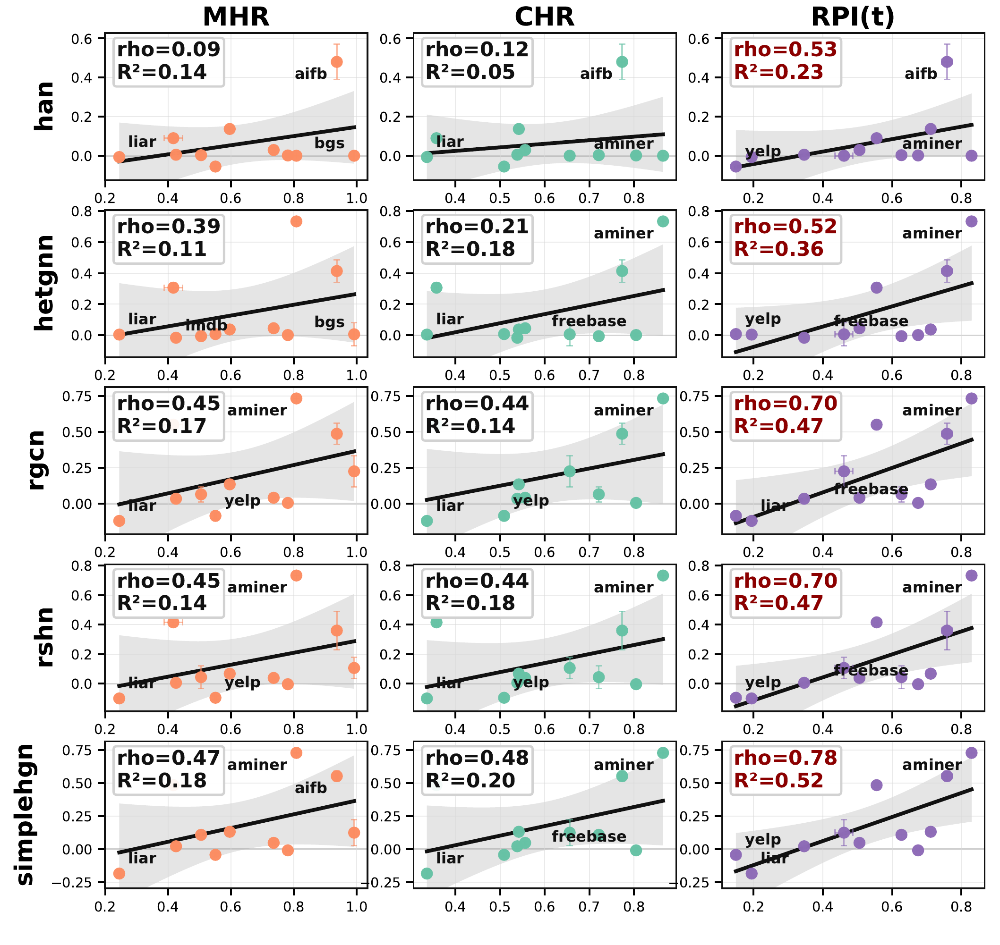

<h1 align="center">Beyond Homophily</h1>

<p align="center"><strong>Relation-wise Predictive Informativeness for Heterogeneous Graph Message Passing</strong></p>
<p align="center"><strong>Accepted at WSDM 2027</strong></p>

<p align="center">
  <a href="#quickstart">Quickstart</a> ·
  <a href="#use-your-own-graph">Use your own graph</a> ·
  <a href="docs/reproduction.md">Reproduce the paper</a> ·
  <a href="docs/WSDM2027-supplementary.pdf">Supplementary material</a>
</p>

Relation-wise Predictive Informativeness (RPI) measures how much of the uncertainty in destination labels is explained by source labels for each edge type. Operational RPI estimates these labels by propagating training labels through a heterogeneous graph, then scores each relation on CPU.

<p align="center">
  <a href="docs/assets/figure-8-hgnn-gains.png"></a>
</p>

**Figure 8 from [Lee et al., WSDM 2027](https://doi.org/10.1145/3862322.3863628).** MHR, CHR, and destination-type operational RPI versus the accuracy gain of each HGNN over an MLP. Each point is one benchmark averaged over five splits. Operational RPI has the highest Spearman correlation for all five backbones.

## Quickstart

From a checkout of this repository, use a Python 3.11 virtual environment and run the included example:

```bash
python3.11 -m venv .venv
source .venv/bin/activate
python -m pip install .
python examples/quickstart.py
```

The example builds a small author–paper graph in memory. It runs on CPU and requires no dataset download. You can skip Git LFS downloads when cloning for this example by setting `GIT_LFS_SKIP_SMUDGE=1`.

```text
author-writes-paper: RPI=1.000 (4 edges)
paper-written_by-author: RPI=1.000 (4 edges)
Target author: RPI=1.000
```

## Use your own graph

Pass a PyTorch Geometric `HeteroData` graph and a Boolean mask for the target nodes whose labels are available for training:

```python
from rpi import compute_rpi

result = compute_rpi(graph, target_type="paper", train_mask=train_mask)

for row in result.relations:
    print((row["src_type"], row["relation_name"], row["dst_type"]), row["RPI"])

print(result.target)
```

- Provide the node count for each type and a `torch.long` `edge_index` of shape `[2, num_edges]` for each relation. Node features are optional.
- Set `graph["paper"].y` to a one-dimensional integer tensor with one entry per target node. Mark training nodes in the Boolean mask. The API uses only their labels, which must be nonnegative. Held-out or unknown labels can be set to `-1`.
- Propagation uses the undirected union of all supplied relations, with defaults `alpha=0.9` and `steps=50`. The score is computed separately on each original directed relation as mutual information divided by destination-label entropy. An empty relation or zero destination-label entropy yields `NaN`.
- `result.node_types` contains the mean of the defined incoming relation scores per destination type, plus an edge-count-weighted mean. `result.target` is the corresponding row for the target type, or `None` if it has no defined incoming scores.

## Run on a paper dataset

In the [reproduction environment](docs/reproduction.md#environment), fetch the AIFB graph and compute operational RPI for one paper split:

```bash
git lfs pull --include="experiments/data/processed/aifb/aifb.pt"
python experiments/realworld/compute_rpi.py --datasets aifb --splits 0 \
  --output-dir experiments/results/aifb-rpi
```

The run writes `rpi_relation.csv`, `rpi_type.csv`, and `rpi_target.csv` under `experiments/results/aifb-rpi/metrics/`. See the [reproduction guide](docs/reproduction.md) for the full benchmark bundle, HCSBM experiments, HGNN alignment, and pruning.

## Licenses

- **Code** is available under the [MIT License](LICENSE).
- **Paper** by Jinmo Lee, Doyun Choi, Minho Jeong, and Jaemin Yoo, including Figure 8 shown above, is licensed under [CC BY-NC-ND 4.0 International](https://creativecommons.org/licenses/by-nc-nd/4.0/).
